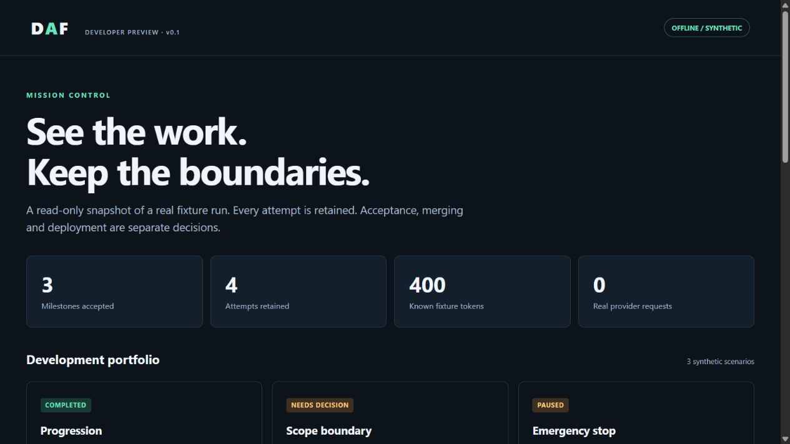

# DAF — Development Autonomy Framework

[](https://github.com/samuelwhite/development-autonomy-framework/actions/workflows/ci.yml)

**v0.1 Developer Preview · offline only · Apache-2.0**

**Desktop candidate for Product review:** [DAF v0.2.1](desktop/README.md) packages
the approved offline graphical demo as a Windows application. Extract its portable
ZIP and open DAF; no developer tools are needed. The candidate is unsigned and is
not a public release or a functional AI development controller. The published
v0.1 preview and Python runtime below are unchanged.

DAF explores how to make AI development work inspectable and recoverable. It turns
explicit plans into tracked milestones, retains failed attempts and acceptance
evidence, and records where work must stop.

This preview lets developers examine those control mechanisms through small Python
components and deterministic, synthetic demonstrations. It makes **no model calls**
and needs no API key, server or Node.js.



*A static, read-only snapshot of synthetic data. The OFFLINE / SYNTHETIC label
applies to every scenario and metric. [Screenshot provenance](docs/screenshot.md).*

## Try it in a minute

Install **Python 3.12 or newer** and Git, then:

```text
git clone https://github.com/samuelwhite/development-autonomy-framework.git
cd development-autonomy-framework/src
python -m daf demo --output ../demo-output
cd ..
```

Open `demo-output/index.html` in your browser. Alternatively, download and unpack
the repository source ZIP, open a terminal in its `src/` directory, and run
`python -m daf demo --output ../demo-output`.

The demonstration runs offline once you have the source and Python. It creates
synthetic JSON and SQLite evidence, then exits. Use a **new output directory**
each time; DAF refuses to overwrite or reopen an existing demo directory.

### Install the command locally

From the repository root:

```text
python -m venv .venv
```

Activate with `.venv\Scripts\Activate.ps1` on Windows PowerShell, or
`source .venv/bin/activate` on Linux/macOS, then:

```text
python -m pip install .
daf-preview demo --output installed-demo-output
```

Open `installed-demo-output/index.html`. Installation downloads the pinned build
backend; the installed runtime uses only Python's standard library. Use the source
walkthrough above to avoid package downloads. There is no package registry release;
install from this repository, not by guessing a package name.

## What you can inspect

- **Progression and correction:** three dependent milestones, four retained attempts,
  and separate simulated developer and validator results.
- **Recovery:** reopened fixture connections reconcile existing jobs without duplicate
  simulated dispatch.
- **Scope and stop boundaries:** an unresolved scope exception stays blocked; a stop
  committed before admission permits no new job.
- **Bounded continuation:** two segments reserve fixture tokens and currency, checkpoint
  context, and refuse a third segment at the budget boundary.

The [walkthrough](docs/demo.md) explains each scenario. Fixture budgets do not prove
provider spending limits, remote cancellation or operating-system isolation. This
preview cannot authenticate an owner, approve live execution, edit a product
repository, merge code, send notifications or deploy. See the full
[capabilities and limitations](docs/capabilities.md).

## Offline supervised handoffs

The separate [receipt bridge](docs/external-receipts.md) exports proposed task
bundles and compares operator-supplied PR/CI records and local artifact bytes.
It never invokes Codex or GitHub. Matching evidence remains unverified and grants
no execution authority. The guide includes a synthetic, offline walkthrough.

## Public GitHub planning input (M1.1, optional)

The source-checkout [pinned planning reader](docs/github-planning-ingestion.md) can retrieve a **public** GitHub plan at an exact commit and produce one deterministic, idempotently stored **proposal**. Its opt-in sidecar uses bounded read-only GitHub requests; the packaged DAF runtime remains offline. This neither authenticates owner approval nor launches Codex.

## Validation and release status

The source is public. All four hosted CI jobs passed on the
[verified launch commit](docs/public-launch.md): Ubuntu and Windows, each with Python
3.12 and 3.13, with **145 tests per job**, lint/format checks, wheel and source-package
smoke tests, and dependency audits. The badge tracks `main`; the linked evidence
records the exact validated commit. macOS is not in that matrix.

The [v0.1 source notes](docs/release-notes-v0.1.md) describe the available preview.
Package metadata is `0.1.0.dev1`. See [GitHub Releases](https://github.com/samuelwhite/development-autonomy-framework/releases)
for published release records. No package registry release is available; use the
source installation above. Offline CI does not establish production readiness or
support for live autonomous execution.

## Explore and contribute

The next iteration has a separate [v0.2 graphical prototype and Product proposal](docs/v0.2-product-proposal.md).
Open `prototype/index.html` from this branch's extracted source ZIP to try the
interactive, simulated setup without installing anything. It does not change or
connect the v0.1 runtime, and is not a new release.

[Why DAF emerged from Victoria](docs/portfolio.md) ·
[Architecture](docs/architecture.md) · [Security](SECURITY.md) ·
[Roadmap](docs/roadmap.md) · [Contributing](CONTRIBUTING.md) ·
[Release checklist](docs/release-checklist.md) · [Licensing](LICENSING.md)
