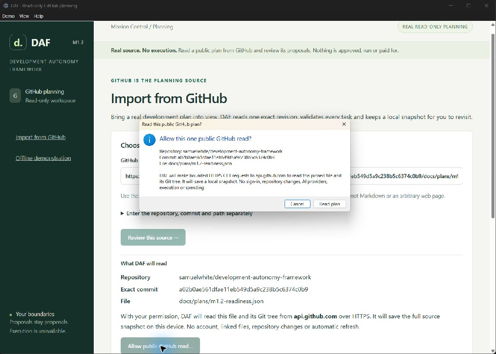
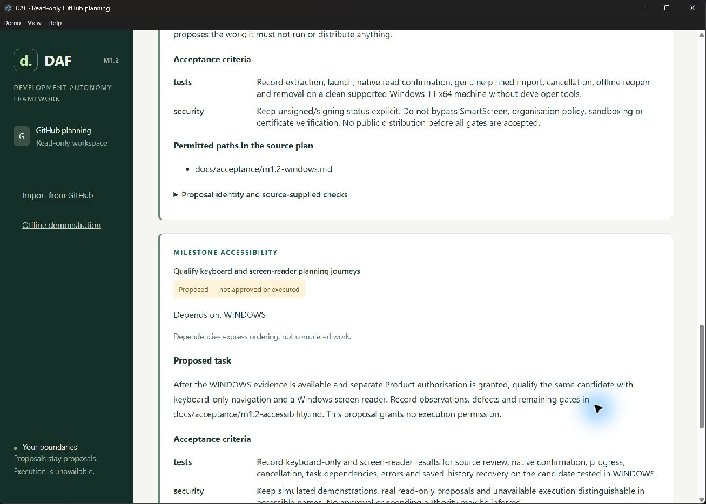
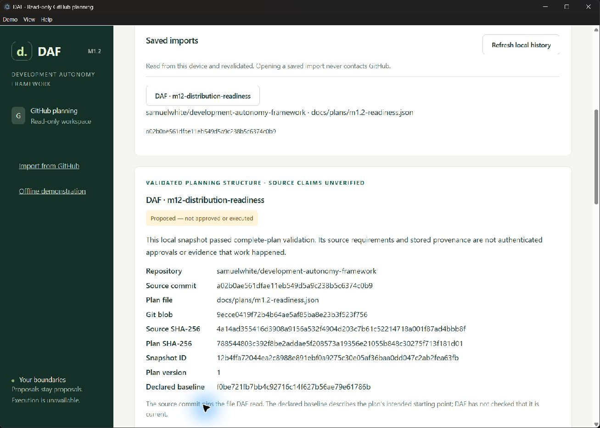

# M1.2 review evidence

30 October 2026. Source and local Windows candidate only; no release, tag or binary
upload. M1.2 remains subject to separate Product review.

## Approved foundation

PR #8 was verified at the approved head
`a08bd7d3b5f5182ef306dadb45182453f6a1fd24` and normally merged as
`f0be721fb7bb4c92716c14f627b56ae79e61786b`. Its merged tree
`def8752f478f863542f26ef90b079194b64ed4f5` equals the approved source tree.
The [four post-merge Python jobs](https://github.com/samuelwhite/development-autonomy-framework/actions/runs/41027056518)
and [Windows/Linux desktop jobs](https://github.com/samuelwhite/development-autonomy-framework/actions/runs/41027163813)
all passed before implementation began.

The published `v0.1.0.dev1` tag remains
`038f1ef33f5233924d35dd773bfa8a25df494be6`. The prototype files, runtime execution
engine, approval/receipt verification controls and repository security policy were
not modified. The existing v0.2.1 package directory is preserved separately.

## Windows candidate

Local file: `dist/m1.2-desktop/DAF-M1.2-windows-x64.zip`.

| Property | Value |
| --- | --- |
| ZIP bytes | 170,994,746 (163.07 MiB) |
| Expanded file bytes | 399,005,804 (380.52 MiB) |
| SHA-256 | `ce1b6cefc184bce208c2ba887ad7bf73b320d299542a0f8d4cc924d8b7a0c5a1` |
| Target | Windows 11 x64, review candidate |
| App metadata | 0.2.2-m1.2; not a tag |
| Included runtimes | Electron 45.1.0; CPython 3.14.10 |
| Ordinary setup | Extract the whole ZIP, open DAF.exe; no developer tools |
| Signing | Unsigned; no security-warning bypass |

The application needs a local writable profile and HTTPS access to public GitHub
only for a user-confirmed import. System clock and certificate trust must work.
Local history works offline. Linux x64 packaging targets Ubuntu 24.04 CI; normal
GUI libraries, CA certificates and a functioning Chromium sandbox are OS
prerequisites. Linux consumer distribution is not qualified.

Archive timestamps mean repeated ZIP builds need not have identical bytes.
Packaging tests compare every shipped host/controller/UI source against the
checkout, check the exact module allowlist, and verify preservation of the original
simulation assets. No engine, worker or CLI is in the planning payload.

## Local validation

- Python suite: 451 passed, 3 skipped for Windows symlink privilege restrictions.
  Overall statement coverage is 91%; the new snapshot module is 100% covered.
  A rerun initially encountered an inaccessible system pytest temporary directory;
  using a fresh task-local directory restored the successful result.
  Ruff check/format passed. Distribution guard reports 20 runtime modules, zero
  runtime dependencies and no live runtime transport. Wheel and source archive
  build/install smoke checks passed outside the checkout; supplied receipts remain
  unverified. Source archives include the new protocol test dependencies.
- Nine JavaScript contract/security tests passed. Coverage includes exact sender
  checks, schema limits, duplicate keys, forged responses, dependency order and
  consent cancelled before a late positive native response.
- Packaged tests cover all three unchanged permission modes, onboarding, milestone
  reviews/exceptions, stop/recovery, keyboard-only Mission Control, 200% planning
  zoom, inert hostile source strings, cancellation and actual parent-process death.
- Real public import/reopen/idempotency/malformed-plan/corruption journeys passed
  before the final extraction run. That final run passed 12/14 checks and exhausted
  GitHub's unauthenticated hourly limit in two live-read checks. The application
  refused with `github_rate_limited`; it did not retry, authenticate or substitute
  a simulation. Final rerun and hosted evidence are recorded below when available.
- Chromium network log: zero outbound transport events; all four deliberate
  network/local-file probes blocked. A separate test-only Python audit observer
  checks actual GET destinations, absence of authorization/listeners/commands and
  offline reopen. It does not replace the production reader.
- `npm audit` and strict `pip-audit` found no known vulnerabilities in the pinned
  dependency sets. Native runtime notices/SBOMs and source references are retained;
  these audits are not a comprehensive native-binary vulnerability assessment.

## Native Windows walkthrough

The real DAF app was launched normally, using its bundled Python rather than an
installed interpreter. The actual native consent dialog was reviewed and accepted.
The public DAF plan at commit
`a02b0ae561dfae11eb549d5a9c238b5c6374c0b9` produced the WINDOWS and ACCESSIBILITY
proposals, with ACCESSIBILITY depending on WINDOWS. The application was closed,
no owned DAF/Python process remained, and cold launch recovered the saved plan.
The complete [walkthrough](m1.2-walkthrough.md) includes error/recovery steps.

Source SHA-256:
`4a14ad355416d3908a9156a532f4904d203c7b61c52214718a001f87ad4bbb8f`.
Snapshot ID:
`12b4ffa72044ea2c8988e891ebf0a9275c30e05af36baa0dd047c2ab2fea63fb`.

CI substitutes only the native consent button response. Transport, source
validation, storage and packaged UI remain real. Windows automated journeys hide
developer tools from PATH. Neither that nor the native walkthrough proves a clean
nondeveloper Windows installation.

## Hosted validation

The first [four-job Python matrix](https://github.com/samuelwhite/development-autonomy-framework/actions/runs/41035339174)
passed at `dcfe9e43270d38d733a1e57c6bb93c7ddc83d813`: 454 tests on each runner,
including symlink tests; 91% overall coverage, distribution checks and audits.
The first [desktop matrix](https://github.com/samuelwhite/development-autonomy-framework/actions/runs/41035339163)
passed 13/14 packaged tests on each platform. Its only failure was a test helper
waiting for the public-import button to become visible during local history
recovery, where the form is correctly hidden. The helper was corrected without
changing application code. Actual GitHub network observation passed on both:
five HTTPS GETs to api.github.com, no authorization, listeners or commands, and
zero further network events when listing/reopening.

Final run links and revision are recorded in the PR and final handover after
completion. Packages remain local to the runners; workflows do not upload
artifacts or publish releases.

## Remaining gates and limits

Code signing, clean Windows acceptance and screen-reader qualification remain
open distribution gates. Linux is experimental. Public schema-1 JSON only; no
private repositories, Markdown conversion, credentials or branch resolution.
Unauthenticated GitHub availability/rate limits and bounded file/tree sizes apply.

The [security and persistence design](adr-002-read-only-desktop-planning.md)
distinguishes structural consistency from authenticated trust. Same-user
self-consistent tampering, local rollback and universal power-loss durability are
not prevented. Local storage must support atomic hard links and must not be a
network or linked folder. Interrupted staging files are never listed as imports;
manual recovery preserves evidence.

No imported plan, review or successful check grants approval, execution or
spending authority. Live providers, paid requests, repository writes, autonomous
workers and execution remain unavailable.
