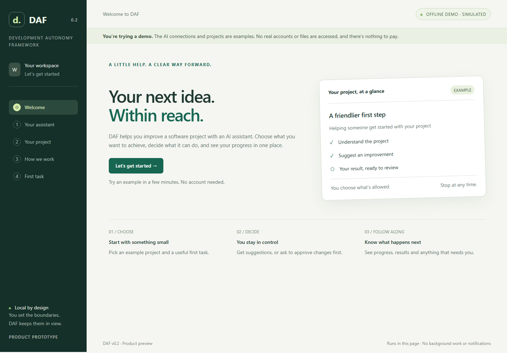
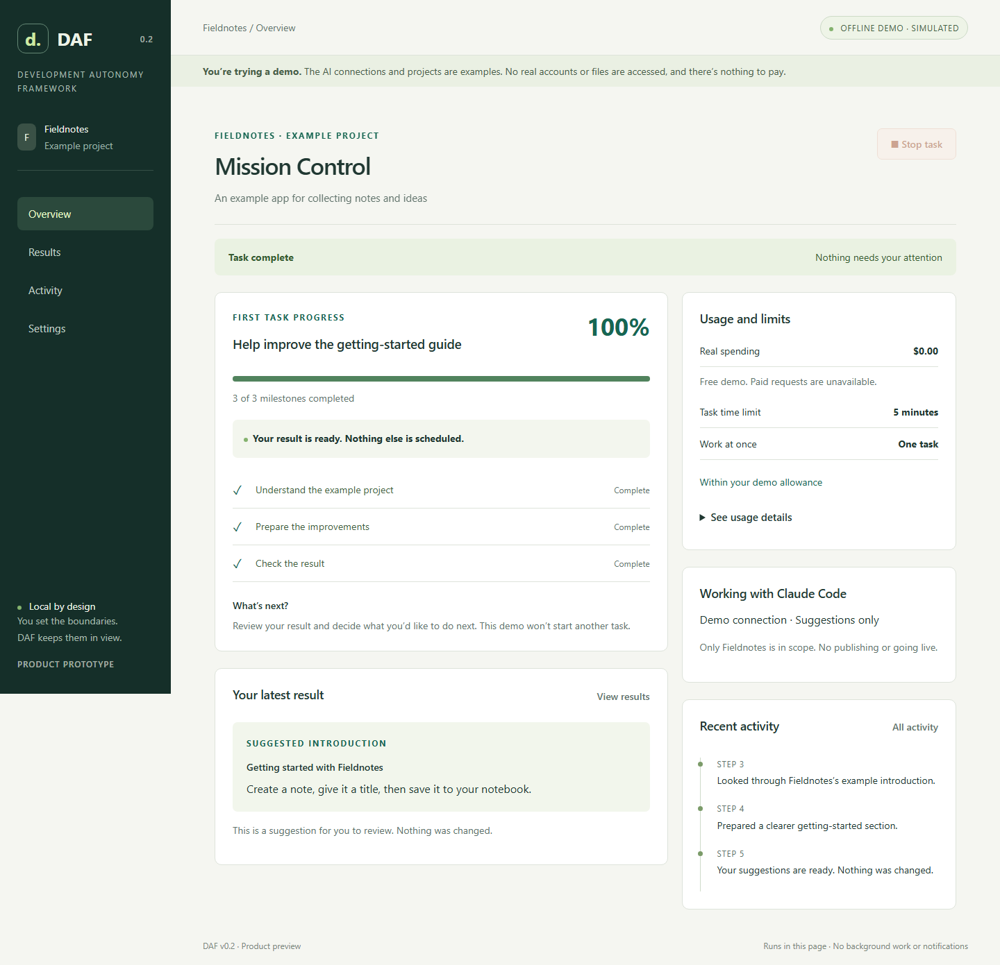

# DAF v0.2 Product walkthrough

Open [`prototype/index.html`](../prototype/index.html) from the extracted source ZIP.
No installation or account is needed. Every connection, project, result and usage
figure is simulated; this page cannot reach real providers or open your files.

## The complete journey

1. **Welcome.** “Your next idea. Within reach.” explains what DAF helps you achieve.
   Select **Let’s get started**. The green and cream visual direction is retained.
2. **Choose your AI assistant.** Neither Codex nor Claude is selected for you. Each
   card explains the proposed account and billing difference in plain language.
   Continue, then **Try the demo connection**; there is no sign-in or credential field.
3. **Choose an example project.** Fieldnotes is an imaginary notes app; Little Library
   is an imaginary book collection app. The cards explain what you will improve.
   **Use my own project** is clearly marked as coming later.
4. **Decide what is allowed.** Keep **Just give me suggestions**, or choose **Make
   changes, but ask me first**. One task, five minutes, no automatic retries and
   zero real cost are clear. Technical limits stay in optional details. Continue;
   checks run automatically and take you straight to the starter tasks if they pass.
5. **Choose an outcome.** Improve the getting-started guide, receive three practical
   suggestions, or get a small plan for adding search. The preview explains what
   happens next. Select **Start example task**; no prompt or second start is needed.
   Custom words are optional and explicitly use the sample documentation demonstration.
6. **Follow Mission Control.** Navigation becomes **Overview / Results / Activity /
   Settings**. Milestones, current work, upcoming work, attention and usage make the
   status visible. Suggestions and plans finish without interruptions. An edit asks
   once, showing the exact example before and after; allow it or decline and stop.
   The attention link jumps to the decision. **Stop task** remains visible on scroll.
7. **Review and return.** Read the completed result and task history. Nothing else
   is scheduled. Reload a completed task to see its saved progress; reload an active
   task to check its earlier work before anything else happens. Settings explains
   the tab-only storage and offers **Start over** once work is safely stopped.

## Try the safety moments

| Where | Try this | Expected behaviour |
| --- | --- | --- |
| Permissions → Explore a setup problem | Connection, permission or limit failure | Explains the problem, why it matters and the next action. Retry keeps the failure; **Fix this** makes the stated correction and rechecks. No bypass. |
| Starter tasks → Explore a task problem | Failed result check | The result is not accepted. The finding and help explain what is missing; no automatic retry. |
| Starter tasks → Explore a task problem | Allowance exceeded | Stops before the next step; explains the shortfall. Limits do not increase. |
| Mission Control | Stop while running or awaiting permission; decline an edit | Stops and invalidates the pending decision. Nothing resumes automatically. |
| Reload during a task | Check earlier work | Keeps the allowance reserved and blocks Start over until the original attempt is checked. No duplicate task. |
| Settings → Explore demo problems, after interruption | Make the earlier result unavailable | Recovery remains blocked with a reason, explicit demo fix, Retry and help. Stop cannot pretend the unknown result is resolved. |
| Settings → Explore demo problems | Reach the time limit | Stops even while waiting for approval. No extension or restart. |

This is a design for returning to work, not a background service. Hidden pages can
pause; closing the tab can lose progress. There are no notifications or durable
recovery. Earlier prototype storage resets to welcome after this update. No v0.1
runtime, journal, release or protection is changed.

## Updated screenshots

Captured from this branch in offline Chromium on Windows, 28 October 2026.
Desktop: 1440 × 1000 viewport; narrow layout: 390 × 844. Images show the full page.

| Journey | Screenshots |
| --- | --- |
| Welcome and assistant choice | [Welcome](v0.2-ux/welcome.png) · [Assistant selection](v0.2-ux/assistants.png) |
| Project and permissions | [Example projects](v0.2-ux/projects.png) · [Friendly permissions](v0.2-ux/permissions.png) |
| First task | [Suggested outcomes and next-step preview](v0.2-ux/starter-tasks.png) |
| Mission Control | [Completed result and progress](v0.2-mission-control.png) · [One edit decision](v0.2-ux/approval.png) · [Narrow layout](v0.2-ux/mobile.png) |
| Attention and return | [Actionable setup failure](v0.2-ux/setup-attention.png) · [Interrupted-work recovery](v0.2-ux/recovery.png) |

The [validation record](v0.2-validation.md) separates automated evidence from the
remaining first-time-user, Linux GUI and real-integration checks. The five-minute
live setup target still needs observed trials; it is not an achieved claim here.
