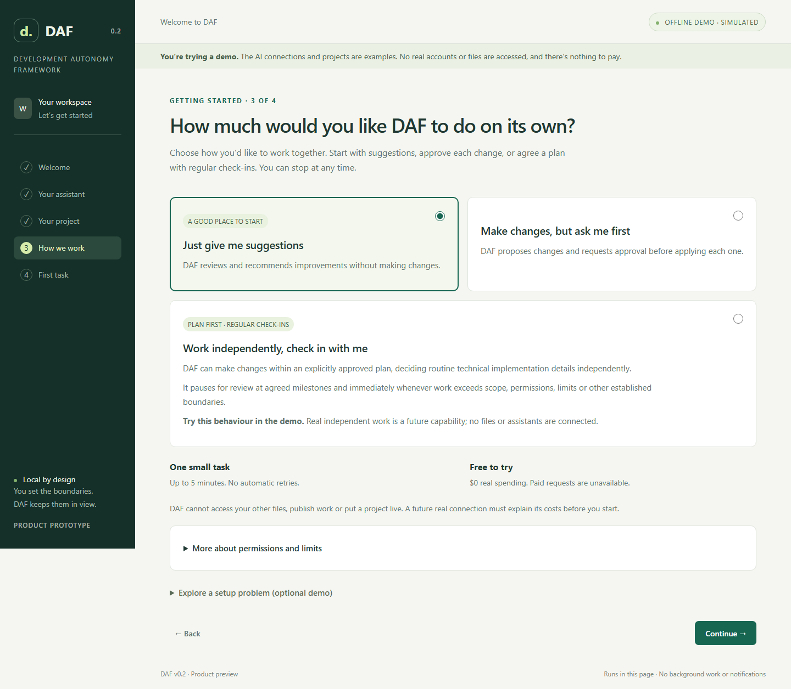
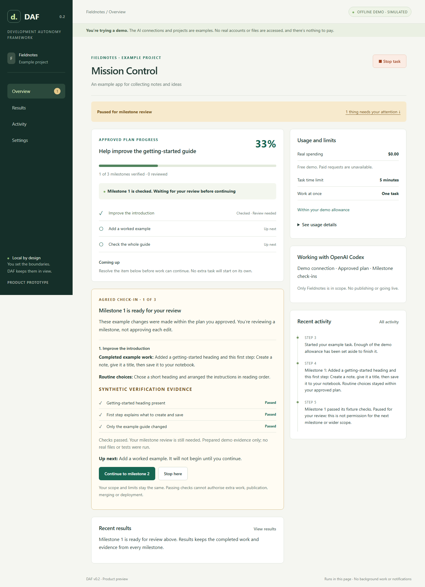

# DAF v0.2 Product walkthrough

Open [`prototype/index.html`](../prototype/index.html) from the extracted source ZIP.
No installation or account is needed. Every connection, project, result and usage
figure is simulated; this page cannot reach real providers or open your files.

## The complete journey

1. **Welcome.** “Your next idea. Within reach.” explains what DAF helps you achieve.
   Select **Let’s get started**. The green and cream visual direction is retained.
2. **Choose your AI assistant.** Neither Codex nor Claude is selected for you. Each
   card explains the proposed account and billing difference in plain language.
   Continue, then **Try the demo connection**; there is no sign-in or credential field.
3. **Choose an example project.** Fieldnotes is an imaginary notes app; Little Library
   is an imaginary book collection app. The cards explain what you will improve.
   **Use my own project** is clearly marked as coming later.
4. **Decide what is allowed.** “How much would you like DAF to do on its own?” offers
   **Just give me suggestions** (the default), **Make changes, but ask me first**,
   and **Work independently, check in with me**. One task, five minutes, no automatic
   retries and zero real cost are clear. Technical limits stay in optional details. Continue;
   checks run automatically and take you straight to the starter tasks if they pass.
5. **Choose an outcome.** Improve the getting-started guide, receive three practical
   suggestions, or get a small plan for adding search. The preview explains what
   happens next. The first two modes use **Start example task**. The third uses
   **Review example plan**, then explicit approval of the plan, scope and limits.
   Custom words are optional and explicitly use the sample documentation demonstration.
6. **Follow Mission Control.** Navigation becomes **Overview / Results / Activity /
   Settings**. Milestones, current work, upcoming work, attention and usage make the
   status visible. In the first two modes, suggestions and plans finish without
   interruptions; an edit shows its exact before and after for approval. In the
   third mode, routine work proceeds inside the agreed plan and every verified
   milestone pauses for review. Exceptions pause work immediately.
   The attention link jumps to the decision. **Stop task** remains visible on scroll.
7. **Review and return.** Read the completed result and task history. Nothing else
   is scheduled. Reload a completed task to see its saved progress; reload an active
   task to check its earlier work before anything else happens. Settings explains
   the tab-only storage and offers **Start over** once work is safely stopped.

## Try “Work independently, check in with me”

1. Choose the third permission option and the getting-started guide task. Select
   **Review example plan**. Nothing has started or used any allowance.
2. Read the three milestones: improve the introduction, add a worked example, and
   check the whole guide. The scope covers only the fictional guide. Routine
   choices include wording, headings, example content and layout. New features,
   other files, shell commands, network access, publication, merging and deployment
   are excluded. Reviews count towards the displayed time limit.
3. Check the three separate confirmations for **plan**, **scope** and **limits**,
   then select **Approve plan and start demo**. Going back to change the task or
   settings clears the confirmations; approval cannot carry over to a changed plan.
4. At each check-in, review completed example work, routine decisions and labelled
   synthetic verification evidence. **Continue to milestone 2/3** acknowledges that
   milestone and continues only the original plan. The final check-in uses **Finish
   and keep the result**. No individual edit approval is requested in this mode.
5. Open **Results** for the work and evidence from all milestones, or **Settings**
   for the approved plan. **Stop here** or the persistent **Stop task** cancels any
   pending decision. Completed example work remains visible: stopping is not undo.

To see an exception after a successful check, choose a boundary problem in the
starter task's optional demo section, approve the plan, then review milestone 1.
The next step pauses before the out-of-bounds action. For an immediate interruption,
use Settings → Explore demo problems → **Pause for this exception** while running
or waiting for review. There is no “ignore and continue” action. Stop, then start
a fresh example and explicitly approve its plan. Publishing, merging and deploying
remain unavailable even in a newly approved demo plan.

Choosing a review or planning starter in this mode still produces **written work
only**. Custom words use the fixed documentation demonstration described in the
plan; they are never interpreted by a model.

## Try the safety moments

| Where | Try this | Expected behaviour |
| --- | --- | --- |
| Permissions → Explore a setup problem | Connection, permission or limit failure | Explains the problem, why it matters and the next action. Retry keeps the failure; **Fix this** makes the stated correction and rechecks. No bypass. |
| Starter tasks → Explore a task problem | Failed result check | The result is not accepted. The finding and help explain what is missing; no automatic retry. |
| Starter tasks → Explore a task problem | Allowance exceeded | Stops before the next step; explains the shortfall. Limits do not increase. |
| Mission Control | Stop while running or awaiting permission; decline an edit | Stops and invalidates the pending decision. Nothing resumes automatically. |
| Reload during a task | Check earlier work | Keeps the allowance reserved and blocks Start over until the original attempt is checked. No duplicate task. |
| Settings → Explore demo problems, after interruption | Make the earlier result unavailable | Recovery remains blocked with a reason, explicit demo fix, Retry and help. Stop cannot pretend the unknown result is resolved. |
| Settings → Explore demo problems | Reach the time limit | Stops even while waiting for approval. No extension or restart. |
| Independent mode → plan approval | Leave any of the three confirmations unchecked | Start remains disabled; no task or allowance is admitted. |
| Independent mode → milestone review | Wait without continuing | Verification alone cannot advance the plan; no extra edits or milestones start. |
| Independent mode → boundary problem | Scope, permission, allowance, unexpected decision, publication, merge or deployment | Pauses before the action. Original limits and scope remain unchanged; no automatic bypass. |
| Reload during independent work, review or exception | Check earlier work | Keeps completed work and remaining reservation, revokes the pending review, and checks the original attempt. Never resumes the plan automatically. |

This is a design for returning to work, not a background service. Hidden pages can
pause; closing the tab can lose progress. There are no notifications or durable
recovery. The previous suggestions/edit demo state is retained, with active work
treated as interrupted. Unrecognised or malformed state resets to welcome. No v0.1
runtime, journal, release or protection is changed.

The third mode demonstrates a proposed interaction. Its plan, work, decisions and
evidence are deterministic browser fixtures. **Real independent execution is a
future capability**, requiring separately reviewed authority, isolation, accounting
and cancellation. A checkbox or successful fixture check cannot enable it.

## Updated screenshots

Captured from this branch in offline Chromium on Windows, 29 October 2026.
Desktop: 1440 × 1000 viewport; narrow layout: 390 × 844. Images show the full page.

| Journey | Screenshots |
| --- | --- |
| Welcome and assistant choice | [Welcome](v0.2-ux/welcome.png) · [Assistant selection](v0.2-ux/assistants.png) |
| Project and permissions | [Example projects](v0.2-ux/projects.png) · [Friendly permissions](v0.2-ux/permissions.png) |
| First task | [Suggested outcomes and next-step preview](v0.2-ux/starter-tasks.png) |
| Mission Control | [Completed result and progress](v0.2-mission-control.png) · [One edit decision](v0.2-ux/approval.png) · [Narrow layout](v0.2-ux/mobile.png) |
| Attention and return | [Actionable setup failure](v0.2-ux/setup-attention.png) · [Interrupted-work recovery](v0.2-ux/recovery.png) |
| Independent mode | [Explicit plan approval](v0.2-ux/independent-plan.png) · [Milestone review and evidence](v0.2-ux/milestone-review.png) · [Boundary pause](v0.2-ux/boundary-pause.png) |
| Independent results and layout | [All milestone results](v0.2-ux/independent-results.png) · [Narrow milestone review](v0.2-ux/independent-mobile.png) |

The [validation record](v0.2-validation.md) separates automated evidence from the
remaining first-time-user, Linux GUI and real-integration checks. The five-minute
live setup target still needs observed trials; it is not an achieved claim here.
